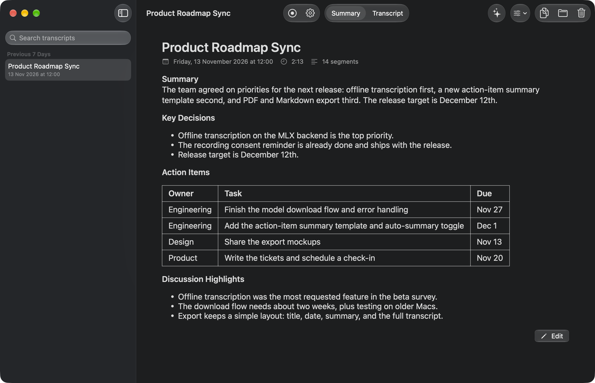
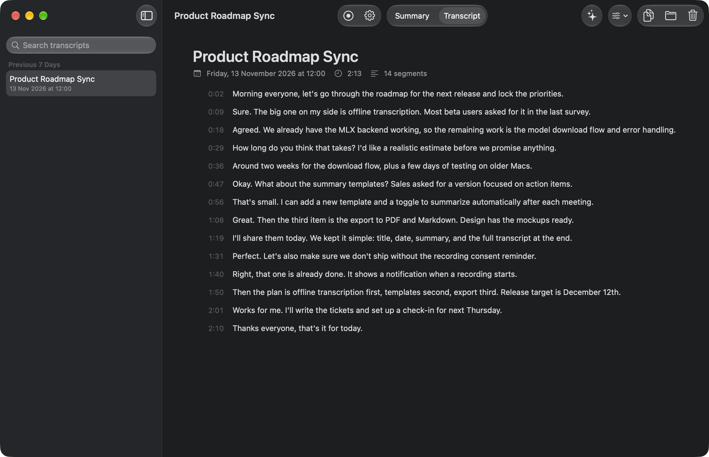
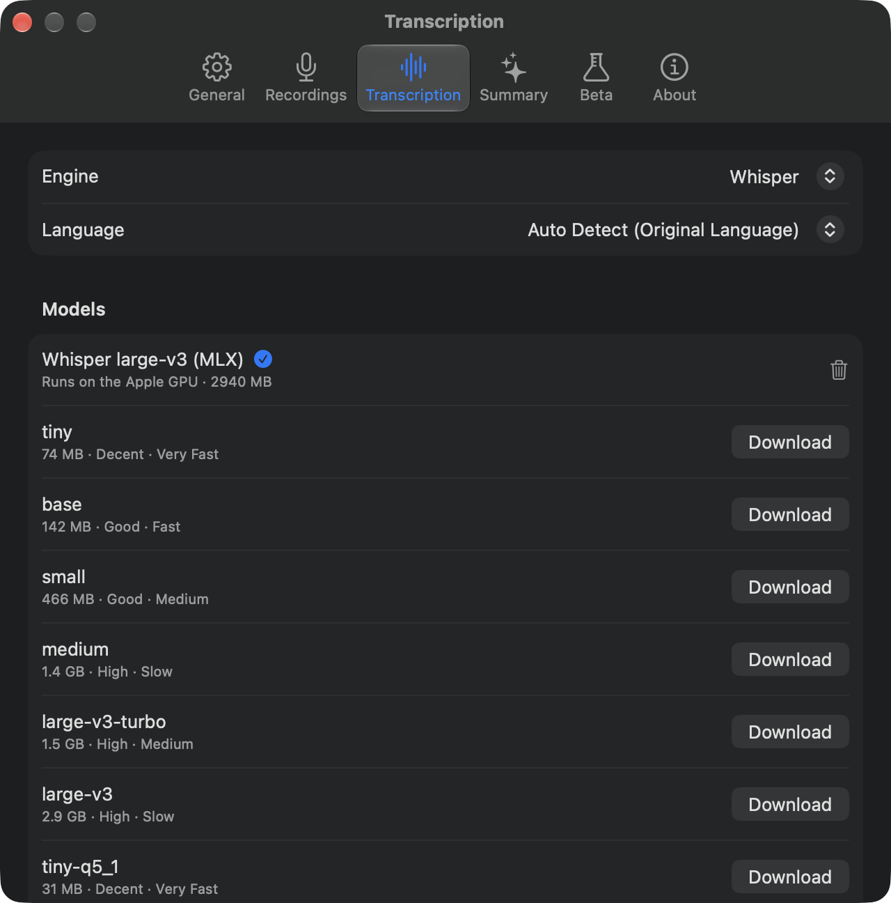

# Meetily Rebuild

A native macOS meeting recorder that transcribes and summarizes your meetings on your own Mac. It's a SwiftUI app built on top of the Rust engine from [Meetily](https://github.com/Zackriya-Solutions/meeting-minutes), with a new interface and an Apple Silicon MLX transcription backend.

Recordings, transcripts and summaries stay on your machine unless you choose a cloud model for summaries.



<p>
  
  
</p>

## Features

- **Record and transcribe live.** Captures your microphone and system audio, and you can pick input devices in Settings.
- **Local speech-to-text.** Choose between Whisper large-v3 running on MLX, the engine's built-in Whisper models, or Parakeet.
- **Import audio.** Bring in an existing recording and transcribe it, or re-transcribe any saved meeting with a different model or language.
- **AI summaries.** Generate a summary with a built-in local model, Ollama, or your own key for OpenAI, Claude, Groq, OpenRouter or any OpenAI-compatible endpoint. Summaries can run automatically after each recording, with a custom prompt.
- **Meeting library.** Search, rename, edit and delete meetings, copy transcripts, and show recordings in Finder.
- **Crash recovery.** An unsaved recording is offered back to you the next time the app starts.
- **Hardware check.** Models your Mac can't run are clearly marked as not supported instead of failing mid-download.

## Requirements

- A Mac with Apple Silicon (M1 or later)
- macOS 26 or later

## Install

1. Download the latest `Meetily-<version>-arm64.dmg` from [Releases](https://github.com/alex-yelisieiev/meetily-rebuild/releases/latest).
2. Open it and drag **Meetily** onto **Applications**.
3. The build isn't signed or notarized yet, so the first time, right-click Meetily in Applications and choose **Open**.

Speech and summary models are downloaded from inside the app the first time you need them.

## Build from source

You need Xcode 26, Rust (stable), Node.js 24, pnpm 12 and Homebrew's `openssl@3`.

```bash
# 1. Sidecar used by the engine for local summaries
cargo build --release -p llama-helper --features metal --target-dir target/sidecar
mkdir -p frontend/src-tauri/binaries
cp target/sidecar/release/llama-helper \
  "frontend/src-tauri/binaries/llama-helper-$(rustc -vV | awk '/host:/{print $2}')"

# 2. Rust engine
cd frontend
pnpm install --frozen-lockfile
OPENSSL_ROOT_DIR="$(brew --prefix openssl@3)" pnpm tauri build --bundles app

# 3. Native app (embeds the engine)
cd ../native
swift build -c release
./build-app.sh        # outputs native/build/Meetily.app
```

Every push to `main` builds the app in GitHub Actions ([`build-macos.yml`](.github/workflows/build-macos.yml)) and publishes a DMG as a new release.

## Project layout

| Path | What's there |
| --- | --- |
| `native/` | The SwiftUI app: UI, settings, MLX runtime manager and the client that talks to the engine |
| `frontend/src-tauri/` | The Rust engine: audio capture, transcription, storage and summaries |
| `llama-helper/` | Local LLM helper process used for built-in summaries |
| `.github/workflows/` | The macOS build and release pipeline |

## Credits and license

This project is based on [Meetily](https://github.com/Zackriya-Solutions/meeting-minutes) by Zackriya Solutions and is distributed under the MIT License. See [LICENSE.md](LICENSE.md), which keeps the original copyright notice. It is an independent rebuild and isn't affiliated with or endorsed by Zackriya Solutions.
